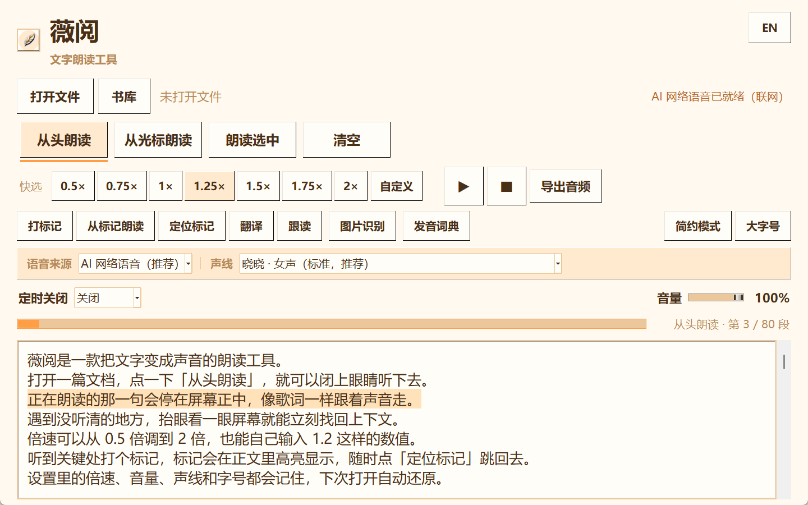

# Weiyue · Text Reader（薇阅 · 文字朗读工具）

> Read with your ears — a warm, ready-to-use text-to-speech reader for Windows.

**English** | [中文文档](README.zh-CN.md)

> **This repository is a modified build based on the original Weiyue v3.0
> (version `v3.0-yunk`).**
> Original project:
> [yshi40198-glitch/weiyue-text-reader](https://github.com/yshi40198-glitch/weiyue-text-reader)
> (MIT License, © the original author)
> The full list of changes is in the `v3.0-yunk` entry of
> [CHANGELOG.md](CHANGELOG.md).

Weiyue turns PDF, Word, EPUB, MOBI, FB2, TXT — and even photos of printed pages —
into natural spoken audio. Whether it's a novel on your commute, work documents
late at night, or English articles for listening practice, Weiyue keeps you
company with a warm, human-like voice.
**Free · Open source · No installation · Unzip and go.**



[](LICENSE)
[](https://github.com/YunkyYunk/weiyue-text-reader)

---

## 1. What it does for you

| Use case | How |
|----------|-----|
| 📖 **Audiobook / e-book listening** | Open EPUB / PDF / TXT / MOBI / FB2, press "Read from Start" and finish whole books with your eyes closed; reopen and it asks "Continue?" right where you stopped |
| 📄 **Listen and follow along** | The text scrolls by itself while reading, keeping the current sentence vertically centred like lyrics — park it on a second monitor and glance over whenever you miss something |
| 🖼️ **Read printed pages & screenshots** | Point the built-in OCR at a photo of a book page or a screenshot — the text is recognized offline and read aloud instantly |
| 🎧 **Chinese & English listening practice** | Translate Chinese <-> English in-app, listen to the translation, or follow along sentence by sentence |
| 🎙️ **Follow-reading (speaking practice)** | Listen to a sentence, record your own voice, replay and compare — like having a speaking partner |
| 💼 **Business docs & meeting materials** | Skim Word / PDF briefs at 2x; mark key points and resume anytime |
| 🌙 **Sleep timer** | Auto-stop after 15 / 30 / 60 / 90 minutes |
| ☁️ **Cloud library · multi-device sync** | Users with their own server (VPS) can connect a cloud library and read the same books on PC and phone |
| 🤖 **AI / automation ready** | AI agents or scripts on your server can drop books and news into the cloud library; Weiyue detects new content and offers to read it |

---

## 2. Quick start (3 steps)

1. Download the source from this repository (or `git clone` it) and unzip.
2. Double-click 「创建桌面快捷方式.bat」 to create a desktop shortcut.
3. Open the app, choose a document, press "Read from Start".

> No Python installation needed — fully portable.
> To run from source instead: `pip install -r requirements.txt`, then
> `python textreader_app.py`.

---

## 3. Reading & controls (most used)

### Three ways to read
- **Read from Start**: read the whole document from the beginning.
- **Read from Cursor**: click a position in the text, then read from there.
- **Read Selection**: select a passage with the mouse, then read only that part
  (it is still split by the normal rules and stops exactly at the end of your
  selection).

Right-click the text for a context menu: read from here, read selection,
cut / copy / paste / delete / select all.

### The play button (since v3.0-yunk)
The **▶** button in the toolbar is smart — it decides what to read by itself:

| Your state | What pressing it does |
|------------|----------------------|
| Text is selected | Reads the selection |
| Cursor is placed somewhere | Reads from the cursor onwards |
| Cursor at the top, a previous position exists | Resumes from where you stopped |
| Cursor at the top, no record | Reads from the beginning |
| No document open | Opens the file dialog |

While reading it turns into **⏸** (pause); when paused it shows **▶** again
(resume). The **⏹** next to it stops.

### Shortcuts
- `Ctrl+O` open file
- `Ctrl+P` pause / resume
- `Esc` stop

### Listening controls
- **Speed**: presets **0.5 / 0.75 / 1 / 1.25 / 1.5 / 1.75 / 2**,
  switching works while reading.
  Need an unusual value like 1.2x? Press "Custom" next to them and type it in
  (capped at 3x).
- **Volume**: slider 0–100%.
- **Voices**: AI neural voices (60+, requires internet); local system voices (offline).
- **Sleep timer**: 15 / 30 / 60 / 90 minutes.

---

## 4. Never lose your place

### Auto resume
- Close the app mid-book and it asks "Continue?" on the next launch.
  One click and you're back where you stopped.
- Progress also saves on Stop / quit and clears after finishing the whole book.

### Your settings are remembered (new in v3.0-yunk)
- Speed, volume, voice source, chosen voice, UI language (中文 / EN) and font
  size are all restored the next time you open the app.
- They live in `weiyue_config.json` next to the app — back it up to keep them.

### Bookmarks (improved in v3.0-yunk)
- Press "Mark" at a key point — **the mark is highlighted right inside the
  text** (amber background with an underline).
- A new **"Go to mark"** button scrolls straight back to it and parks it in the
  vertical centre of the view, so you can't miss it. Multiple marks are
  supported and cleared when you switch books.

### Pronunciation dictionary
- Add "word = reading" pairs (e.g. iPhone = ai-fon) for names, brands and
  homographs. Applies to reading, follow-reading and audio export.

---

## 5. Library

### Local library
- Choose a folder of e-books (Calibre library or your own novels folder).
- Weiyue scans automatically and lists title / author / format; double-click to
  read. Remembers your last folder.
- Supports EPUB / PDF / Word / TXT / MOBI / FB2 / HTML.
- **Delete & recycle bin**: press "Delete Book" to move a book to the recycle
  bin; the recycle bin lets you "Restore" or "Delete Forever".

### Cloud library (connect your own VPS)
- Weiyue connects to **no server by default** — fully local and private.
- If you have your own server (VPS), open "Library → Cloud Library → Server
  Settings" and enter your server address:
  - Read the same books on PC and phone.
  - When new books or news appear on the server, Weiyue notifies you
    ("Cloud library has new content").
  - Deleting cloud books requires an admin key (never embedded in the code).
- Server-side components live in the `server/` directory (book scan, voice
  relay, EPUB conversion, etc.) for those who want to self-host. Weiyue only
  connects to the server you configure — never to any third party.

---

## 6. Learning features

### Translation
- Translate Chinese <-> English in-app; long text is auto-split; results can be
  read aloud with pause / stop.

### Follow-reading (repeater mode)
- Open an article, then "Follow": listen to each sentence (pause / resume /
  stop, repeat 1 / 3 / 5 times or loop).
- Record your own reading, replay and compare. 3-minute cap per recording;
  recordings live in memory only.

### Image OCR
- Recognize text from photos, screenshots and scanned pages using the built-in
  Windows engine — fully offline.

### Smart filter (automatic)
- Skips page numbers, headers and footers while reading for a cleaner listen.

---

## 7. Export audio

- Export AI voice to MP3 or local voice to WAV; long documents retry
  automatically.

---

## 8. Morning news (AI / automation friendly)

- A 「早间新闻」 folder is created next to the app: drop today's news
  (txt/md) in and Weiyue offers to read it on startup.
- With a cloud server configured, Weiyue also fetches today's news from the
  server's 「早间新闻」 folder automatically (great for AI agents or scripts
  that generate news daily).
- The tray menu also opens the latest news anytime.

---

## 9. Other features

- **Bilingual UI**: one-click switch between 中文 and English.
- **Big-text mode**: enlarge the reader with one click, easier for seniors.
- **Simple mode (new in v3.0-yunk)**: hide every toolbar with one click and
  keep only the text area, with a small "Back to full interface" bar on top.
  Handy for parking the window on a second monitor — highlighting and
  auto-scroll keep working while reading.
- **Auto-scroll while reading (improved in v3.0-yunk)**: the text scrolls
  smoothly and keeps the current paragraph vertically centred; a paragraph that
  wraps onto several lines is followed line by line as the audio progresses.
  Pausing playback also pauses the scrolling.
- **System tray**: closing minimizes to tray (reading continues); tray menu
  offers pause / stop / morning news / quit.
- **Read a link**: paste a news/article URL and read the extracted text aloud.
- **Config file**: `weiyue_config.json` stores your settings (library folder,
  pronunciation dictionary, server address, reading progress, speed / volume /
  font size…) — back it up to keep settings.

---

## 10. Developers: run from source

```bash
pip install -r requirements.txt
python textreader_app.py
```

> Note: Image OCR uses the Windows built-in OCR engine — make sure the
> "Chinese (Simplified) OCR" language pack is installed in Windows settings.

---

## 11. Tech stack

- UI: Python Tkinter (warm sunrise theme, embossed buttons)
- AI voice: edge-tts (neural voices, requires internet)
- Offline fallback: Windows SAPI system voices
- OCR: Windows.Media.Ocr (offline, built-in engine)
- Recording: sounddevice / numpy
- Text extraction: PyMuPDF / python-docx / HTMLParser / built-in MOBI & FB2
- Cloud: configurable server address, no server connected by default

### What v3.0-yunk changed in the reading engine
- **Chunking**: 40-character baseline with an 80-character ceiling; the cut
  point is the punctuation closest to the 40-character boundary, and commas /
  enumeration commas / semicolons / colons all count. **Line breaks are cut
  first**, so every line of text becomes its own chunk.
- **Synthesis**: AI voice paragraphs are synthesised 5 at a time in the
  background (was strictly one at a time).
- **Playback**: chunks play in index order (concurrent results arrive out of
  order, so they are re-ordered internally), and the leading/trailing silence
  baked into each clip is trimmed using the word-level timestamps.

---

## 12. Contributing

Issues and pull requests about the original project belong in the
[original repository](https://github.com/yshi40198-glitch/weiyue-text-reader);
for anything about this modified build, use [this repo's issues](../../issues).

1. Found a problem or have an idea? Open an [Issue](../../issues)
2. Want to improve the code? Fork the repo and submit a [Pull Request](../../pulls)
3. Like it? Give it a ⭐ — and please star the original project too

See [CONTRIBUTING.md](CONTRIBUTING.md) for details.

---

## 13. License & origin

[MIT License](LICENSE) — free to use, modify and distribute.

**Origin**: this repository is a modified version of
[yshi40198-glitch/weiyue-text-reader](https://github.com/yshi40198-glitch/weiyue-text-reader)
(Weiyue v3.0), released here as `v3.0-yunk`. The original author's copyright and
the MIT license are fully retained; the changes are limited to the listening
experience and are listed in [CHANGELOG.md](CHANGELOG.md).
